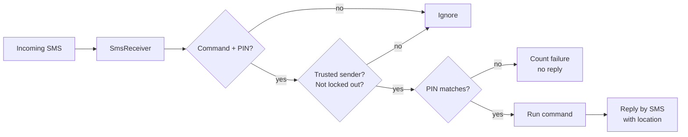

# PhoneGuard

**An Android anti-theft app that answers secret SMS commands — no internet account, no cloud dashboard.**

Text your phone from any other phone and it texts back its location, locks the screen, rings an alarm, or calls you back. Commands are protected by a PIN you choose, and wrong guesses get no reply.

<p>
  
  
  
  
</p>

## Why SMS?

If a phone is stolen, mobile data, Wi-Fi and even the SIM may be gone. SMS still arrives on the stolen phone as long as it has power and a network. PhoneGuard listens for a short text, verifies the PIN, acts, and replies over SMS — so it works from a borrowed phone with no app installed.

## Commands

Send exactly **`<command> <PIN>`** from a trusted number:

| Command | Aliases | What happens |
|---|---|---|
| `LOC 1234` | `LOCATE`, `WHERE`, `موقع`, `وين` | Replies with a Google Maps link, GPS accuracy and battery level |
| `LOCK 1234` | `قفل`, `اقفل` | Locks the screen (needs device-admin permission) |
| `ALARM 1234` | `RING`, `SIREN`, `صفارة`, `انذار` | Locks the screen, then rings at full alarm volume for 3 minutes — even on silent |
| `TRACK 1234` | `FOLLOW`, `تتبع`, `تعقب` | Sends a location every 10 minutes, 12 times (2 hours) |
| `CALL 1234` | `اتصل`, `دق` | The phone silently calls you back so you can hear what is around it |
| `INFO 1234` | `STATUS`, `معلومات`, `حالة` | Replies with battery, SIM, network, and whether lost mode or tracking is on |
| `STOP 1234` | `وقف`, `اوقف` | Stops the alarm and tracking, and ends lost mode |

Notes:

- `1234` is your PIN. Arabic-Indic (٠١٢٣) and Persian (۰۱۲۳) digits work too.
- **Wrong PINs get no reply.** After 5 wrong attempts, commands pause for 30 minutes.
- Replies never contain the PIN, because Android copies outgoing texts into the stolen phone's Sent folder.
- `LOCK` can reply with nothing, "locked", or the location — configurable in the app.
- The alarm also stops when someone unlocks the phone: only the owner knows the screen lock.

## Features

- **Location over SMS** — a foreground service waits for a GPS fix (up to 60 s) instead of relying on a receiver's ~10 s budget, then replies with a Maps link.
- **Lost mode** — `LOCK`, `ALARM`, `TRACK` and `CALL` switch it on. The app shows a full-screen message over the lock screen so an honest finder can return the phone.
- **New SIM alert** — texts your trusted numbers from the new SIM, including its number and a location.
- **Wrong-unlock alert** — after 3 failed PIN/pattern attempts, texts your trusted numbers the location.
- **Low-battery alert** — in lost mode, sends one last location at 10% battery.
- **Sender policy** — accept commands from *any number* (easiest when borrowing a phone) or *trusted numbers only* (safer, since commands stay visible in the stolen phone's inbox).
- **Trusted numbers** — added manually or picked from contacts; matching ignores country/prefix formatting.
- **Test mode** — preview the exact reply a command would send, without sending an SMS.
- **Arabic & English** — command words, numbers and the UI are localized; RTL is supported.

## How it works



- `SmsReceiver` parses the message, checks sender, PIN and lockout, then dispatches.
- `CommandService` is a short-lived foreground service that keeps the process alive while waiting for a fix, so replies are not lost.
- `Prefs` stores settings in `SharedPreferences`; the PIN is kept only as a salted SHA-256 hash.
- Nothing is uploaded anywhere: the app uses SMS and the system location API, and opens no backend of its own.

## Setup

1. **Install the app**
   - Copy `PhoneGuard.apk` to the phone and open it (allow installs from unknown sources), or
   - over USB: `adb install PhoneGuard.apk`
2. **Open the app and complete every ✅ step**
   - Phone & messages permission (receive, send, read phone state, call)
   - Location, then **"Allow all the time"** — required for background commands
   - Device admin (lock permission)
   - Battery optimization exemption
   - Full-screen notification permission (Android 14+) for the lost screen
   - A screen lock PIN or pattern — without one, locking protects nothing
3. **Set a PIN** (at least 4 digits) and **add at least one trusted number**.
4. **Test it** from another phone: send `LOC <your PIN>`.

On Xiaomi, Huawei, Oppo and similar OEMs, also enable **Autostart** for PhoneGuard, otherwise the system may block SMS delivery or kill the app.

## Security model

| Threat | Mitigation |
|---|---|
| Someone reads the stolen phone's inbox | Commands are one-shot; use trusted-senders-only and change the PIN after recovery |
| PIN guessing | 5 wrong attempts → 30-minute lockout; failures are silent |
| PIN theft from the device | Only a salted SHA-256 hash is stored, never the PIN |
| App removal | Device admin must be deactivated first (factory reset still removes it) |
| Reply leaking the PIN | Replies never echo the PIN |

## Limitations

- A powered-off phone, or one with the SIM removed, receives no commands.
- After a reboot, Android does not deliver SMS to any app until the phone is unlocked once.
- If the thief disables location, the reply contains the last known position plus a warning.
- A factory reset removes the app. Also enable your Google account and Find My Device — they provide FRP protection after a reset.
- Google Play does not allow apps that use SMS permissions this way, so PhoneGuard is **manual-install only** (sideload or ADB).
- Location accuracy depends on the device, indoors GPS may take a while or fall back to network location.

## Build from source

Requirements: **JDK 17** and the **Android SDK 35** (set `sdk.dir` in `local.properties`).

```bash
./gradlew assembleDebug
```

Output: `app/build/outputs/apk/debug/app-debug.apk`

| Component | Version |
|---|---|
| Kotlin | 2.0.21 |
| Android Gradle Plugin | 8.7.2 |
| Gradle | 8.9 |
| minSdk / targetSdk | 26 / 35 |

The prebuilt, debug-signed `PhoneGuard.apk` in the repo root can be installed directly.

## Project structure

```
app/src/main/java/com/theftguard/
├── MainActivity.kt      Setup checklist, PIN, trusted numbers, lost screen, test
├── SmsReceiver.kt       Parses commands, verifies sender/PIN, dispatches
├── CommandService.kt    Foreground service that waits for a fix and replies
├── Responder.kt         Shared "locate and text back" logic
├── Locator.kt           Location acquisition and human-readable description
├── SmsSender.kt         Sends replies on the right SIM
├── Prefs.kt             Settings storage, PIN hashing, lockout
├── Device.kt            Device admin, lock, call, info
├── LostMode.kt          Lost-mode state and lock-screen message
├── AlarmService.kt      Full-volume alarm that ignores silent mode
├── Tracker.kt           Periodic location updates
├── Watchers.kt          SIM-change, failed-unlock, low-battery alerts
└── Text.kt              Command parsing, Arabic digit normalization
```

## Disclaimer

PhoneGuard is intended for **your own devices**. Use it only on phones you own or are authorized to manage. Sideloading apps and granting device-admin/SMS permissions carries risk — review the source before installing.
